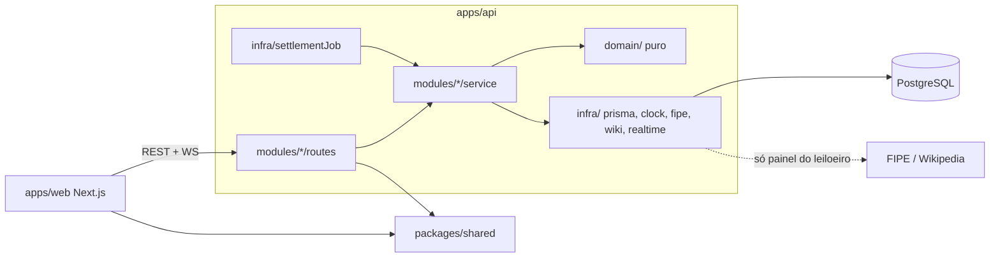

# Architecture Spine — LanceAuto

O PRD vence em conflito. Aqui só o que ele não fixa. Versões de libs e hosts são `[ASSUMPTION]`: confirmar no dia 1 e deixar o lockfile mandar.

## Design Paradigm

Monólito modular. **Um processo** de API (Express + Socket.IO + timer de fechamento) e **um** Postgres. Sem filas, cache distribuído ou microsserviços.



- `domain/`: funções puras (regras de lance, `lotStatus`, cadeia HMAC, pseudônimo). Não importa Prisma, Express nem `Date.now`.
- `routes`: validam com zod, autenticam, chamam um service. Sem regra de negócio.
- `services`: abrem a transação, orquestram, devolvem eventos. Único lugar que escreve no banco.
- Direção de dependência: `routes → services → domain`; `services → infra`; `domain → nada`. `web` nunca importa `apps/api`.

## Invariants & Rules

### AD-1 — Mutação só por REST; Socket.IO só transmite [ADOPTED parcial]
- **Binds:** lances, depósito, cancelamento, tempo real
- **Prevents:** dois caminhos de escrita com regras diferentes
- **Rule:** todo POST/PUT passa por um service. Socket.IO é servidor→cliente (exceto `lot:join`, que só devolve snapshot). Eventos são publicados **depois do commit**: o service devolve `DomainEvent[]`, a rota entrega ao `Publisher`.

### AD-2 — Ordem de lock única
- **Binds:** bid, cancel, settle, deposit
- **Prevents:** deadlock e saldo inconsistente (PRD regras 5, 8, 13)
- **Rule:** transação `ReadCommitted` interativa do Prisma. Ordem fixa: (1) `SELECT … FROM "Lot" WHERE id=$1 FOR UPDATE`; (2) carteiras envolvidas numa só query `WHERE "userId" IN (…) ORDER BY "userId" FOR UPDATE`. Depósito trava só a própria carteira. Nunca travar carteira antes do lote.

### AD-3 — Dinheiro em centavos: `bigint` no banco, `number` fora
- **Binds:** todo valor monetário
- **Prevents:** float, overflow (Int32 estoura em R$ 21 mi)
- **Rule:** colunas `BigInt`; a conversão para `number` acontece só nos mappers do repositório, com assert `≤ Number.MAX_SAFE_INTEGER`. API e eventos trafegam inteiros (`…Cents`). Formatação BRL só no front (`packages/shared/money`). `MAX_DEPOSIT_CENTS = 1_000_000_000`.

### AD-4 — Carteira = cache; ledger = verdade auditável
- **Binds:** carteira, extrato, estorno, liquidação
- **Prevents:** saldo que não fecha com o extrato
- **Rule:** `Wallet(total, committed)` é atualizada na mesma transação que insere `LedgerEntry` (append-only, com `totalAfter`/`committedAfter`). Constraints no banco: `committed >= 0` e `total >= committed`. Disponível é sempre calculado (`total − committed`), nunca gravado.

| LedgerKind | Efeito | Quando |
| --- | --- | --- |
| `DEPOSIT` | total + | depósito |
| `HOLD` | committed + | assumiu a liderança |
| `RELEASE` | committed − | foi superado (mesma tx do lance que superou) |
| `REFUND` | committed − | lote cancelado com lances (estorno ao líder) |
| `SALE_DEBIT` | total −, committed − | liquidação, vencedor |
| `SALE_CREDIT` | total + | liquidação, leiloeiro |

Extrato do front mostra todos; "superado" = `RELEASE`, "Estorno" = só `REFUND`.

### AD-5 — Transação do lance (ordem de validação fixa)
- **Binds:** `POST /lots/:id/bids`, PRD regras 1–8, 10; EXPERIENCE P32, P34
- **Prevents:** dois líderes, prorrogação duplicada, código de recusa diferente conforme o caminho
- **Rule:** `ROLE_NOT_ALLOWED` (403) sai antes da transação. Dentro dela, com o lote travado e `now = clock.now()`, valida **nesta ordem** e para na primeira falha:
  1. `LOT_CANCELLED` → 2. `LOT_NOT_STARTED` → 3. `LOT_ENDED` (`now >= endsAt`) → 4. `ALREADY_WINNING` → 5. `BELOW_MINIMUM` → 6. `INSUFFICIENT_BALANCE` (`amount > total − committed`).

  Sucesso, tudo na mesma tx: `RELEASE` ao líder anterior (se houver) → `HOLD` ao novo → `Bid` com `seq = entryCount+1` e hash (AD-8) → atualiza `currentBidCents`, `leaderId`, `bidCount`, `entryCount`, `lastHash`, `seal` → se `endsAt − now <= 2 min`, `endsAt = now + 2 min` (`originalEndsAt` nunca muda).

  O cliente envia `expectedCurrentCents` (o que ele viu; `null` = sem lances). `BELOW_MINIMUM.details.reason = OUTDATED` se `expectedCurrentCents` ≠ lance atual real, senão `MINIMUM`.

### AD-6 — Fechamento: um timer, idempotente, lock-protegido
- **Binds:** PRD regras 11–13; EXPERIENCE P6
- **Prevents:** liquidação dupla, lance/fechamento em corrida
- **Rule:** `setInterval` de 5 s no processo da API + uma varredura no boot. Busca `endsAt <= now AND settledAt IS NULL AND cancelledAt IS NULL` com `FOR UPDATE SKIP LOCKED`; por lote, uma tx: relê `endsAt`/`settledAt` sob lock e só então liquida (`SALE_DEBIT`/`SALE_CREDIT`, `Receipt` único por lote, `settledAt = now`). Sem lances: só `settledAt`. Leituras (`GET`) **nunca** liquidam. Entre `endsAt` e `settledAt` o status é `CLOSING` ("apurando"); o front refaz `GET` a cada 3 s nesse estado.

### AD-7 — Status do lote é função pura
- **Binds:** vitrine, sala, painel, Meus arremates; EXPERIENCE P27
- **Prevents:** cada tela calculando estado de um jeito
- **Rule:** `lotStatus(lot, now)` em `packages/shared`: `CANCELLED` (cancelledAt) · `SCHEDULED` (now<startsAt) · `LIVE` (now<endsAt) · `CLOSING` (settledAt nulo) · `SOLD` (bidCount>0) · `UNSOLD`. Estado do licitante por lote: `LEADING`, `OUTBID`, `WON`, `LOST` (deu lance e outro venceu), `CANCELLED`. Servidor devolve `status` já calculado + `serverTime`.

### AD-8 — Cadeia de auditoria HMAC-SHA256 v1 [ADOPTED]
- **Binds:** `Bid`, `Lot.lastHash/seal`, `Receipt.finalHash`, `GET /lots/:id/audit`
- **Prevents:** dois formatos de hash, cadeia que não recalcula
- **Rule:** chave `AUDIT_HMAC_KEY` (≥ 32 bytes, só env). Saída em hex minúsculo. Campos nulos viram string vazia; `at` em ISO UTC com milissegundos (`2026-10-22T14:00:00.123Z`); valores em centavos inteiros; separador `|`.
  - `genesis = HMAC(key, "v1|genesis|{lotId}|{startsAt}|{startingBidCents}|{minIncrementCents}")`
  - `hash   = HMAC(key, "v1|entry|{lotId}|{seq}|{kind}|{pseudonym}|{amountCents}|{at}|{prevHash}")`; `prevHash` da seq 1 = `genesis`
  - `seal   = HMAC(key, "v1|seal|{lotId}|{entryCount}|{lastHash}")`; no lote novo `lastHash = genesis`, `entryCount = 0`
  - `kind ∈ {BID, CANCEL}`. `CANCEL` entra na cadeia como linha própria (seq seguinte, sem pseudônimo nem valor) e **conta** no veredito (P11).
  - Veredito (`verifyChain` em `domain/`): `OK` · `BROKEN_AT {seq}` (primeira linha cujo hash ou sequência não bate) · `SEAL_MISMATCH` (cadeia consistente, mas contagem/último hash ≠ selo: sumiço de finais, P31) · `RECEIPT_MISMATCH`. Lote sem lances e íntegro = `OK` com 0 linhas.
  - Migração cria trigger que rejeita `UPDATE`/`DELETE` em `Bid`; o teste de adulteração o desativa com `ALTER TABLE … DISABLE TRIGGER`.

### AD-9 — Pseudônimo e privacidade
- **Binds:** auditoria, comprovante, sala, Meus arremates; EXPERIENCE P39
- **Prevents:** vazamento de `userId`/e-mail, pseudônimo igual entre lotes
- **Rule:** `pseudonym = "Licitante " + HMAC(key, "v1|pseudo|{userId}|{lotId}")[0:4].toUpperCase()`, gravado em `Bid`. DTOs públicos **nunca** contêm `userId`, nome ou e-mail. Logado, `GET /lots/:id` devolve `myPseudonym`, `myRank`, `myBestBidCents`; o front compara pseudônimos para mostrar "você". `myRank = 1 + nº de licitantes cujo maior lance > o meu`. Colisão de 4 hex no mesmo lote é aceita e vai no README.

### AD-10 — Tempo: servidor manda, `Clock` injetável
- **Binds:** tudo que lê hora
- **Prevents:** contagem diferente por máquina, teste e seed impossíveis
- **Rule:** `new Date()`/`Date.now()` proibidos fora de `infra/clock.ts`; services recebem `Clock`. Toda resposta e evento traz `serverTime`; o front guarda `offset = serverTime − Date.now()` e exibe `Date.now() + offset`. Datas em ISO UTC (`Z`); UI mostra `America/Sao_Paulo` (P38).

### AD-11 — Autenticação: JWT Bearer, um papel por conta
- **Binds:** auth, Socket.IO, autorização
- **Prevents:** cookie cross-site bloqueado (web e API em domínios diferentes) e proxy de WS inexistente na Vercel
- **Rule:** `bcryptjs` (custo 10); JWT HS256 (`JWT_SECRET`), 7 dias, claims `sub`, `role`; sem refresh. Front guarda em `localStorage`, envia `Authorization: Bearer` e `auth: { token }` no handshake. Logout = descartar o token (P7). E-mail normalizado em minúsculas. Middleware `requireAuth` / `requireRole(role)`; dono do recurso conferido no service (`ROLE_NOT_ALLOWED`/`FORBIDDEN`). Rotas protegidas no front redirecionam visitante para `/entrar?next=`; papel errado vai para a home do próprio papel (P8). Pós-login: licitante → vitrine, leiloeiro → painel.

### AD-12 — API externa isolada; telas públicas leem só o banco
- **Binds:** `modules/catalog`, criação de lote; PRD "Gestão da API externa"
- **Prevents:** tela pública quebrando com a FIPE fora
- **Rule:** só `infra/fipe.ts` e `infra/wikipedia.ts` fazem HTTP externo; só as rotas `/catalog/*` e `POST /lots` os usam. Cache em memória (`Map`, TTL 24 h, **serve cache vencido se a chamada falhar**). Timeout 4 s, 2 tentativas. Falha → `503 EXTERNAL_UNAVAILABLE` (só o painel mostra). Imagem baixada **no momento da criação** (também quando a URL é do leiloeiro: só http/https, bloqueia IP privado/loopback, máx. 2 MB, tipo `image/*`) e gravada em `Item.imageData`; servida em `GET /items/:id/image` com cache. Falha no download → sem imagem (front usa ilustração padrão). Seed lê um JSON local, sem rede.

### AD-13 — Contratos vivem em `packages/shared`
- **Binds:** web ↔ api
- **Prevents:** tipos duplicados que divergem
- **Rule:** `packages/shared` exporta: schemas zod de entrada, DTOs de saída, `ErrorCode`, nomes/payloads de eventos, `lotStatus`, `money`. Só depende de `zod`. Dado novo na fronteira = muda aqui primeiro.

## Contratos de API

Envelope de erro: `{ "error": { "code": "…", "message": "pt-BR", "details": {…}? } }`. Sucesso: JSON direto, sem envelope. Todo `GET` de lote/estado inclui `serverTime`.

| Código | HTTP | `details` |
| --- | --- | --- |
| `BELOW_MINIMUM` | 422 | `{ minimumCents, currentBidCents, reason: MINIMUM\|OUTDATED }` |
| `INSUFFICIENT_BALANCE` | 422 | `{ availableCents }` |
| `ALREADY_WINNING` | 409 | — |
| `LOT_NOT_STARTED` | 409 | `{ startsAt }` |
| `LOT_ENDED` | 409 | — |
| `LOT_CANCELLED` | 409 | — |
| `LOT_CHANGED` | 409 | `{ entryCount }` (cancelamento com lance novo, P36) |
| `ROLE_NOT_ALLOWED` | 403 | — |
| `FORBIDDEN` | 403 | — (não é dono) |
| `UNAUTHENTICATED` | 401 | — |
| `VALIDATION` | 400 | `{ fields: { campo: msg } }` (inclui `DEPOSIT_OUT_OF_RANGE` como campo `amountCents`) |
| `EMAIL_TAKEN` | 409 | — |
| `INVALID_CREDENTIALS` | 401 | — |
| `NOT_FOUND` | 404 | — (lote, token ou imagem inexistente, P12) |
| `EXTERNAL_UNAVAILABLE` | 503 | `{ source: FIPE\|WIKIPEDIA }` |

| Rota | Papel | Corpo → resposta |
| --- | --- | --- |
| `POST /auth/register` | — | `{name,email,password≥8,role}` → `201 {token,user}` (cria `Wallet` para todos) |
| `POST /auth/login` | — | `{email,password}` → `{token,user}` |
| `GET /me` | logado | `{user, wallet?}` |
| `GET /lots?status&q&brand` | público | `{lots: LotCard[], brands: string[]}` sem paginação; `q` ignora acento/caixa (coluna `searchText` normalizada); ordem: ao vivo por `endsAt↑`, agendado por `startsAt↑`, encerrado por `endsAt↓`; cancelados nunca |
| `GET /lots/:id` | público (+token opcional) | `LotState`: lote, snapshot do carro, `status`, `bids[]` (públicos), `myPseudonym/myRank/myBestBidCents` se logado, `serverTime`. Cancelado e agendado também respondem (P1, P2) |
| `POST /lots/:id/bids` | licitante | `{amountCents, expectedCurrentCents\|null}` → `201 {bid, lot: LotState-resumo, wallet}` |
| `GET /lots/:id/audit` | público | `{lot, entries[], verdict, verifiedAt}` — recalcula a cada chamada (retrato + "Verificar de novo", P30); inclui linha `CANCEL` |
| `GET /receipts/:token` | público | `{lotNumber, car, amountCents, settledAt, winnerPseudonym, finalHash, receiptCode, auditUrl}` |
| `GET /wallet` | logado | `{totalCents,committedCents,availableCents,entries[]}` (50 últimos, `?before=` para mais) |
| `POST /wallet/deposits` | licitante | `{amountCents}` `1…MAX_DEPOSIT_CENTS` → `201 {wallet}` |
| `GET /me/bids` | licitante | `[{lot: LotCard, state: LEADING\|OUTBID\|WON\|LOST\|CANCELLED, myBestBidCents, receiptToken?}]` |
| `GET /catalog/brands` · `/brands/:b/models` · `/models/:m/years` | leiloeiro | passa-through da FIPE (cache) |
| `GET /catalog/preview?brand&model&year` | leiloeiro | `{car, suggestedImage?: {url, credit}}` |
| `POST /lots` | leiloeiro | `{brandId,modelId,yearId,title,imageUrl?,startingBidCents≥100,minIncrementCents≥100,startsAt,endsAt}` → `201 LotState`; regras: `endsAt − startsAt ≥ 5 min`, `startsAt ≥ agora − 60 s` |
| `GET /my/lots` | leiloeiro | `{lots: [LotCard+resultado], totalReceivedCents}` (inclui cancelados, P10) |
| `POST /lots/:id/cancel` | leiloeiro dono | `{confirmEntryCount}` → `LotState`; só `SCHEDULED`/`LIVE`; se `entryCount` ≠ confirmado → `LOT_CHANGED`; com lances: `REFUND` ao líder + linha `CANCEL` na cadeia |
| `GET /items/:id/image` | público | bytes + `Cache-Control` |
| `GET /health` | público | `{ok, db}` |

`LotCard`: `{id, number, title, brand, year, status, currentBidCents|null, startingBidCents, bidCount, startsAt, endsAt, imageUrl}`. `number` é `Lot.number` sequencial exibido com 3 dígitos (P18); `receiptCode = "{number}-{token[0:4].upper}"` é derivado, não gravado.

## Eventos Socket.IO

Conexão com `auth: { token? }` opcional. Servidor entra o socket em `user:{id}` se o token for válido. Payloads sempre com `serverTime`. Eventos de lote carregam `version = entryCount`; o cliente ignora `version <= atual` e refaz `GET` se houver salto.

| Evento (S→C) | Sala | Payload |
| --- | --- | --- |
| `bid:placed` | `lot:{id}` | `{lotId, version, bid:{seq,pseudonym,amountCents,at}, currentBidCents, bidCount, endsAt, extended}` |
| `lot:closed` | `lot:{id}` | `{lotId, version, outcome: SOLD\|UNSOLD, finalBidCents?, winnerPseudonym?, finalHash?}` |
| `lot:cancelled` | `lot:{id}` | `{lotId, version}` (P2) |
| `showcase:lot` | `showcase` | `LotCard` (novo lote, lance, prorrogação, fechamento, cancelamento; P33) |
| `wallet:updated` | `user:{id}` | `{totalCents,committedCents,availableCents}` |

| Evento (C→S) | Ack |
| --- | --- |
| `lot:join {lotId}` | `LotState` (snapshot atual). Cliente emite a cada `connect` e reconexão; é a reconciliação, sem replay |
| `showcase:join` | — |

Vitrine e Painel ficam abertos em `showcase`; páginas sem socket funcionam por `GET` (degradação aceitável, P16).

## Consistency Conventions

| Concern | Convention |
| --- | --- |
| Nomes | tabelas/models Prisma no singular PascalCase; JSON e eventos em camelCase; eventos `recurso:ação`; enums em `UPPER_SNAKE`; arquivos `kebab-case.ts` |
| IDs / datas | `uuid` em tudo; token do comprovante = 24 bytes `base64url` aleatórios; datas ISO UTC `Z`, colunas `timestamp(3)` |
| Front | App Router; TanStack Query para estado do servidor (eventos fazem `setQueryData`); um `apiClient` único; Tailwind com tokens do `DESIGN.md` como CSS variables; tema `data-theme` no `<html>` definido por script inline antes da pintura (sistema por padrão, chave manual em `localStorage`, P22); páginas públicas podem renderizar no servidor chamando a API sem token |
| Validação | zod nas bordas (rota e formulário); nunca dentro de `domain/` |
| Config | `env.ts` com zod, falha no boot; segredos só em env; `.env.example` completo |
| Logs / segurança | pino com `requestId`; `helmet`; CORS só `WEB_ORIGIN`; `express-rate-limit` em `/auth/*` e `POST …/bids` |
| Testes | Vitest. Unit em `domain/`; integração contra Postgres real (`DATABASE_URL_TEST`); `Promise.all` de lances para concorrência; teste de adulteração via SQL cru; Publisher falso captura eventos |
| Commits | atômicos, pt-BR (ver `progresso.md`) |

## Stack

| Nome | Versão |
| --- | --- |
| Node.js | LTS ativo no dia 1 |
| TypeScript | 5.x |
| Next.js (App Router) + React | major atual no dia 1 |
| Express + Socket.IO | 4.x / 4.x |
| PostgreSQL + Prisma | 16+ / major atual no dia 1 |
| zod, TanStack Query, Tailwind, bcryptjs, jsonwebtoken, pino, helmet, Vitest | majors atuais no dia 1 |
| Gerenciador | npm workspaces |

## Structural Seed

```text
/
  apps/
    web/                 # Next.js
    api/
      prisma/            # schema.prisma, migrations/ (inclui CHECKs e trigger), seed.ts, fipe-fixture.json
      src/
        domain/          # bid-rules, audit-chain, pseudonym  (puro)
        modules/         # auth, wallet, lots, bids, audit, receipts, catalog
        infra/           # prisma, clock, fipe, wikipedia, image-store, realtime, settlement-job
        env.ts  server.ts
  packages/shared/       # schemas, DTOs, ErrorCode, eventos, lotStatus, money
  docker-compose.yml     # db, api, web
  README.md  .env.example
```

```prisma
enum Role { AUCTIONEER BIDDER }
enum LedgerKind { DEPOSIT HOLD RELEASE REFUND SALE_DEBIT SALE_CREDIT }
enum ChainKind { BID CANCEL }

model User   { id String @id @default(uuid()); name String; email String @unique; passwordHash String; role Role; createdAt DateTime @default(now()); wallet Wallet? }
model Wallet { userId String @id; totalCents BigInt @default(0); committedCents BigInt @default(0); updatedAt DateTime @updatedAt } // CHECK committed>=0, total>=committed
model LedgerEntry { id String @id @default(uuid()); userId String; kind LedgerKind; amountCents BigInt; lotId String?; totalAfter BigInt; committedAfter BigInt; createdAt DateTime @default(now()); @@index([userId, createdAt]) }
model Item {
  id String @id @default(uuid()); source String; externalId String; brand String; model String; year Int; fuel String
  referencePriceCents BigInt; referenceMonth String; imageData Bytes?; imageMime String?; imageCredit String?; rawData Json; fetchedAt DateTime
}
model Lot {
  id String @id @default(uuid()); number Int @unique @default(autoincrement())
  auctioneerId String; itemId String; title String; searchText String
  startingBidCents BigInt; minIncrementCents BigInt
  startsAt DateTime; endsAt DateTime; originalEndsAt DateTime
  currentBidCents BigInt?; leaderId String?; bidCount Int @default(0); entryCount Int @default(0)
  lastHash String; seal String
  cancelledAt DateTime?; settledAt DateTime?; createdAt DateTime @default(now())
  @@index([endsAt]) @@index([auctioneerId])
}
model Bid { // só inserção (trigger)
  id String @id @default(uuid()); lotId String; seq Int; kind ChainKind
  bidderId String?; pseudonym String?; amountCents BigInt?; at DateTime
  prevHash String; hash String
  @@unique([lotId, seq])
}
model Receipt { id String @id @default(uuid()); lotId String @unique; winnerId String; pseudonym String; amountCents BigInt; token String @unique; finalHash String; issuedAt DateTime }
```

### Ambientes e deploy mínimo (dia 1)

| Ambiente | Onde |
| --- | --- |
| Local | `docker compose up` (db + api + web); API roda `prisma migrate deploy` no start; seed por `npm run seed` (recusa se já houver usuários) e `npm run seed:demo` (recria o lote ao vivo) |
| Produção | web na Vercel; API em Render (web service, aceita WebSocket); Postgres gerenciado (Neon). `DATABASE_URL` pooled + `DIRECT_URL` para migrações |

Variáveis: `DATABASE_URL`, `DIRECT_URL`, `JWT_SECRET`, `AUDIT_HMAC_KEY`, `WEB_ORIGIN`, `FIPE_BASE_URL`, `FIPE_TOKEN?`, `WIKI_USER_AGENT`, `PORT`, `NEXT_PUBLIC_API_URL`.

Critério do "deploy mínimo" no dia 1: web publicada chama `/health` da API publicada (CORS ok), socket conecta, migração aplicada, e há um segredo de HMAC em produção. Seed: lances criados pelos próprios services com `Clock` falso para fabricar lotes encerrados/arrematados com cadeia válida; lote ao vivo com 30 dias.

## Capability → Architecture Map

| Área (PRD) | Vive em | Governado por |
| --- | --- | --- |
| Cadastro/login, papéis | `modules/auth`, middleware | AD-11 |
| Busca FIPE, criação de lote | `modules/catalog`, `modules/lots` | AD-12, AD-3, AD-8 (genesis/seal) |
| Vitrine | `modules/lots` + `showcase` | AD-7, AD-13 |
| Lance, saldo, prorrogação | `modules/bids`, `domain/bid-rules` | AD-2, AD-3, AD-4, AD-5, AD-10 |
| Sala ao vivo, reconexão | `infra/realtime`, `lot:join` | AD-1, eventos |
| Encerramento, liquidação, comprovante | `infra/settlement-job`, `modules/receipts` | AD-6, AD-4 |
| Cancelamento com estorno | `modules/lots` | AD-2, AD-4, AD-8 |
| Auditoria, privacidade | `modules/audit`, `domain/audit-chain` | AD-8, AD-9 |
| Resiliência à API externa | `infra/fipe`, `infra/wikipedia` | AD-12 |
| Seed, testes, Compose | `prisma/seed.ts`, Vitest | AD-10, Conventions |

## Deferred

- **Mais de uma instância da API:** o timer tolera (`SKIP LOCKED`), mas Socket.IO exigiria adapter (Redis). Fica fora; uma instância basta.
- **Colisão de pseudônimo (4 hex) no mesmo lote:** aceita e documentada no README.
- **Idempotência de lance por chave do cliente:** o duplo clique já cai em `ALREADY_WINNING`.
- **Assinatura Ed25519 e verificação no navegador:** evolução citada no PRD, fora do escopo.
- **Hibernação do plano grátis do Render:** timer para; a varredura do boot liquida o atraso. Citar no README; ping externo opcional.
- **Textos, layouts e estados vazios** (P3–P5, P9, P13–P15, P17, P19–P21, P24–P26, P28–P29, P35, P37, P40): são de UX, sem impacto de contrato; o implementador segue o `EXPERIENCE.md`.
